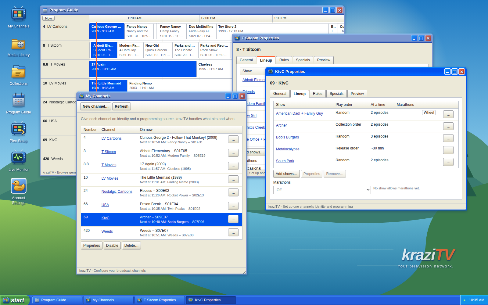
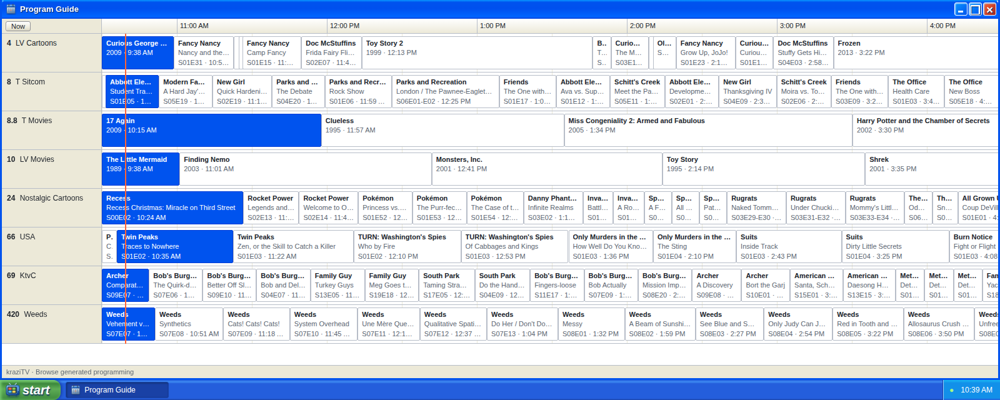
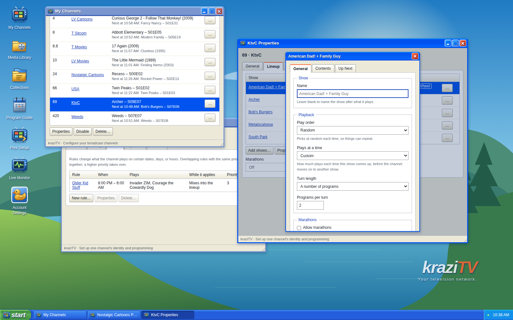
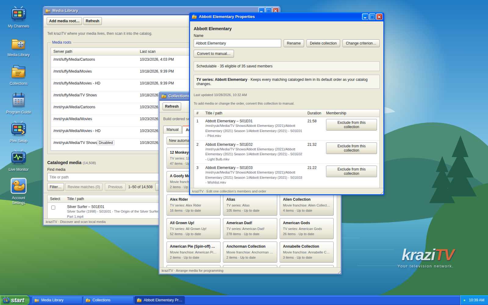

# kraziTV

**Your movies and shows, as live TV channels in Plex.**

kraziTV turns your media library into a lineup of channels that broadcast
around the clock. Tune in and you land partway through whatever is on, just
like real TV. No more scrolling for something to watch. Pick a channel and
let it play.

You set up channels once, in a web app that looks and feels like Windows XP,
and kraziTV keeps programming them for as long as it runs.



## Why kraziTV

- **Channels that program themselves.** Give a channel a lineup of shows,
  movies, or collections. kraziTV takes turns between them, plays a couple of
  episodes at a time, and picks each show up where it left off. It never runs
  out.
- **Real TV habits.** Shows can play in episode order, release order, your
  own order, or shuffled. Let a show break into a marathon now and then.
  Mix two shows into one "wheel" slot, the way networks once did.
- **Rules for times and seasons.** Cartoons on Saturday mornings, horror all
  October, Christmas specials in December, late-night shows after 8 PM.
- **Specials at exact times.** Book a movie for 8:00 PM Friday. Regular
  programming wraps up cleanly before it starts.
- **Your library, understood.** With a free TMDB key, kraziTV recognizes your
  shows, seasons, and episodes from file and folder names, and suggests a
  collection for each series and franchise in your library. Keep the ones you
  want.
- **A full guide in Plex.** kraziTV shows up in Plex as a TV tuner with a
  program guide, so it works on every TV, phone, and tablet Plex does.
- **One stream per channel.** Everyone watching a channel shares the same
  broadcast, so the third viewer costs no more than the first.

## A Look Around

Every channel's next day, at a glance:



Shows, play order, and rules, each in its own Properties window:



Scan your folders and keep the collections kraziTV suggests:



## Get Started

kraziTV runs anywhere Docker does:

```bash
docker run -d --name krazitv -p 3000:3000 \
  -v krazitv-data:/data \
  -v /path/to/your/media:/media:ro \
  -e PUBLIC_BASE_URL=http://192.168.1.10:3000 \
  -e KRAZITV_PROGRAMMING_TIMEZONE=America/New_York \
  ghcr.io/ridloncmr/krazitv:v0.9.0-rc.1
```

Replace `192.168.1.10` with your server's address, open it in a browser, and
create your account. Then:

1. **Media Library:** add `/media`, and scan it when kraziTV offers.
2. **My Channels:** create a channel and add shows to its lineup.
3. **Plex Setup:** copy the two addresses into Plex's **Live TV & DVR**
   settings.

That's it. Your channels are in Plex Live TV.

Prefer to build kraziTV from source? See [CONTRIBUTING.md](CONTRIBUTING.md).

The [setup guide](docs/knowledge_base/running-krazitv.md) covers running
without Docker, connecting Plex step by step, and every setting.

## Where It Stands

kraziTV is young and actively developed. Today:

- It works with **Plex**. Jellyfin support is planned.
- Watch in Plex, or in the browser with the TV program.
- Every channel is re-encoded to 1080p H.264, so watching uses some CPU.
- It is meant for a **home network**. Anyone who can reach it can watch its
  channels, so don't expose it to the internet.

Found a bug or have an idea? [Open an issue](https://github.com/ridloncmr/kraziTV/issues).

## Contributing

kraziTV is written in TypeScript, with Fastify and SQLite on the server, React
in the browser, and FFmpeg for the streams. See
[CONTRIBUTING.md](CONTRIBUTING.md) to get a development setup running.

## License

Copyright (c) 2026 Christian Ridlon. kraziTV is free software under the
[GNU Affero General Public License, version 3 or later](LICENSE). Use it,
change it, and share it, commercially or not. If you share it, or run a
changed version that others use over a network, you must share its source
under the same license. Third-party notices are in
[THIRD_PARTY_NOTICES.md](THIRD_PARTY_NOTICES.md).
