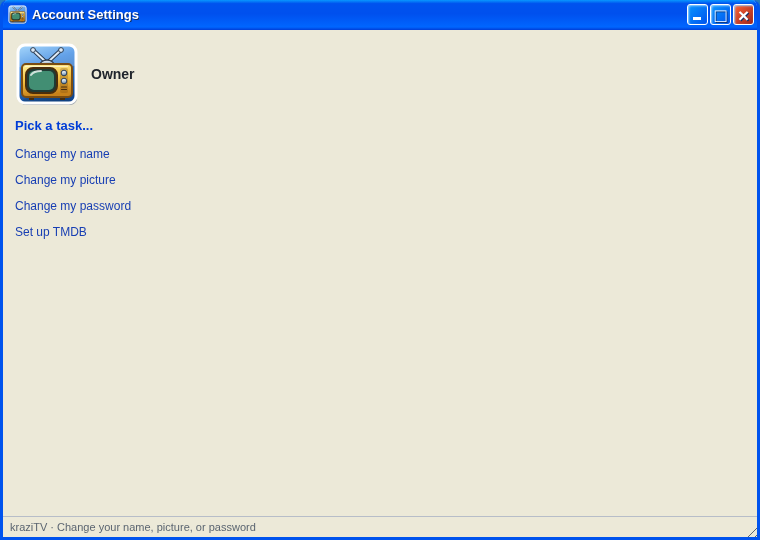
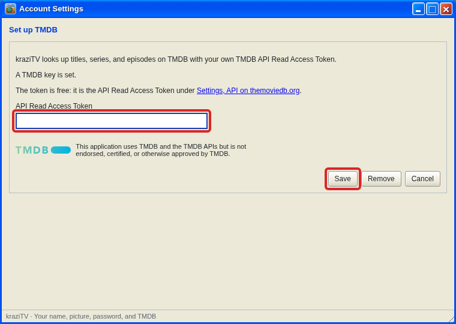

# Account Settings

kraziTV has one account: the person who administers it. Account Settings
is where you change its name, picture, and password, and where the TMDB key
lives.



## Your name and picture

**Change my name** sets the name shown on the logon screen. **Change my
picture** picks one of the built-in pictures, which also serves as the
Account Settings icon on the desktop.

## Your password

**Change my password** asks for the current password and the new one, at
least eight characters. Every other browser is logged out when you change
it; the one you are using stays logged in.

A browser stays logged in for thirty days of use. **Log Off** on the Start
menu logs that browser out right away.

### If you forget it

Run this on the computer kraziTV runs on. kraziTV can keep running.

```bash
# Docker
docker exec -it krazitv node apps/server/dist/reset-password.js

# From source, in the kraziTV folder
npm run reset-password
```

It asks for the new password twice, replaces the old one, and logs every
browser out. It needs a real terminal, which is why the Docker command has
`-it`, and if kraziTV happens to be writing at that moment it asks you to
try again.

## Set up TMDB

TMDB is the free database kraziTV uses to recognize your shows and movies.
Without a key, it only knows what your file names say, and cannot build
automatic collections for series or franchises.

1. Create a free account at [themoviedb.org](https://www.themoviedb.org/)
   and open **Settings**, then **API**.
2. Copy the long **API Read Access Token**. That is your key; not the
   shorter API Key.
3. In Account Settings, choose **Set up TMDB**, paste it, and click
   **Save**. The reminder balloon in the system tray has a **Set up TMDB**
   button that takes you straight there, and so does the **Set up TMDB…**
   button at the top of [Media Library](Media-Library) until a key is saved.



kraziTV checks the key with TMDB before saving it. The yellow tray icon
goes away once a key is set. If you added the key after scanning, scan
each root again in [Media Library](Media-Library) so your files get looked
up.

**Remove** deletes the key. Matches already made stay as they are.

---

**Next:** [How programming works](How-Programming-Works), or back to
[First run](First-Run#4-keep-some-collections) if you came from there.
