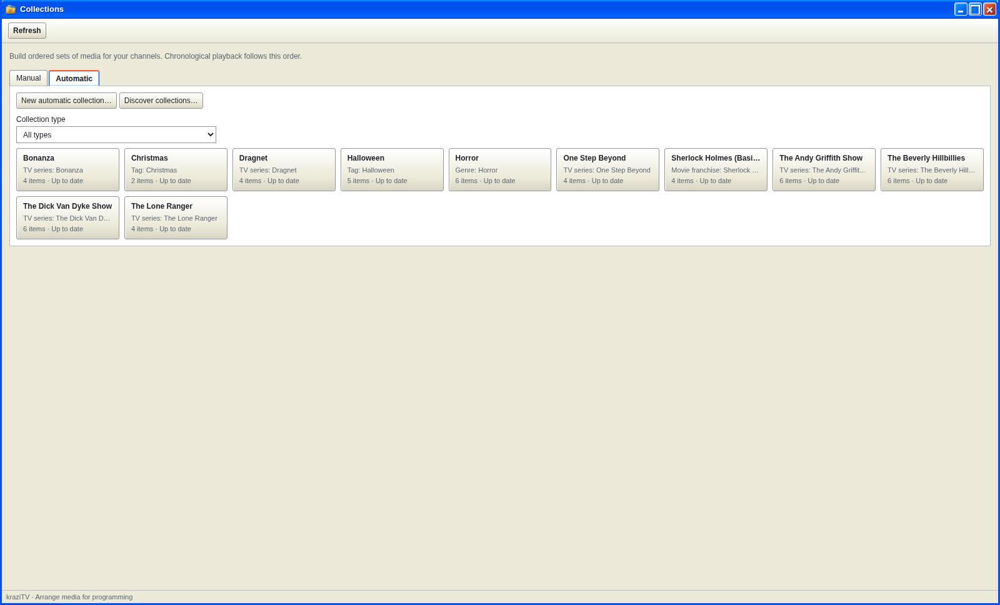
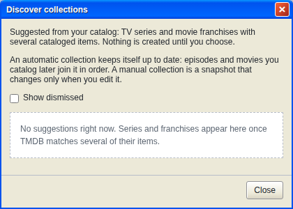
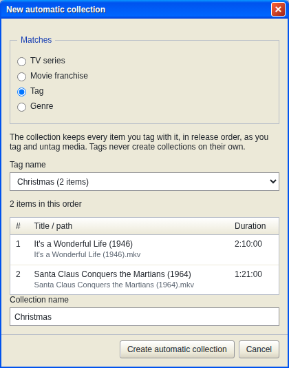
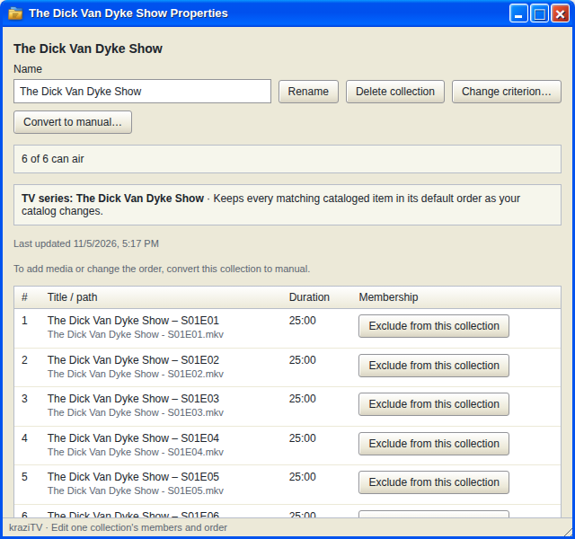
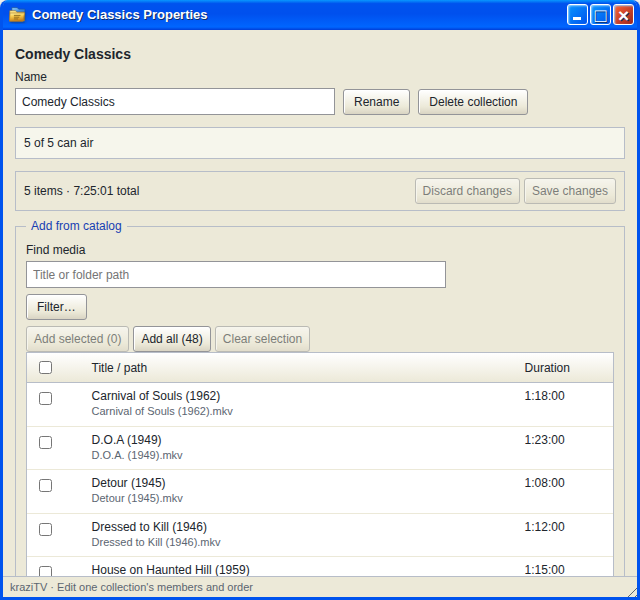

# Collections

A collection is a set of media a channel can play: every episode of a
series, all the films in a franchise, everything you tagged `Christmas`, or
a list you put together by hand. Channels play collections, so this is
where your channels' raw material comes from.

## Two kinds

**Automatic collections** keep themselves up to date. You pick one thing
they match on, and kraziTV adds every file that fits, now and after every
future scan. There are four kinds:

| Kind                | Keeps                                | In this order      |
| ------------------- | ------------------------------------ | ------------------ |
| **TV series**       | Every episode of one series          | Season and episode |
| **Movie franchise** | Every film TMDB lists in a franchise | Release date       |
| **Tag**             | Every file you gave that tag         | Release date       |
| **Genre**           | Every file TMDB puts in a genre      | Release date       |

**Manual collections** change only when you edit them. Use one when no
single rule describes what you want: a mix of favorite episodes from
several shows, say, or movies in the order you want them played.

Both kinds work the same on a channel. The channel decides the play order;
a collection's own order only matters when the channel plays it in
**Collection order**. See [Play order](Play-Order).

## Let kraziTV suggest them

On either tab, click **Discover collections…**. kraziTV lists
every TV series and movie franchise with at least two cataloged files, with
a reason and a member list. For each one:

- **Create automatic collection** makes it and keeps it up to date.
- **Save as manual collection** takes a snapshot that never changes.
- **Dismiss** hides it. Tick **Show dismissed** later to bring it back.

The dialog stays open so you can go down the list. Suggestions are worked
out fresh each time you open it, so come back after adding new shows.

## Make one yourself

**New automatic collection…** on the Automatic tab asks what to match: a
series, a franchise, a tag, or a genre. Pick one and the dialog shows what
it would contain before you create it. Tags come from
[Media Library](Media-Library#tags).

**New collection…** on the Manual tab creates an empty collection and opens
it so you can fill it.

## Collection Properties

Clicking any collection opens its own window.

The top line tells you how much of it can air. Files that are missing or
too short stay in the collection but are skipped on the air.

**Automatic collections** show their members read-only. To keep one file
out, click **Exclude from this collection** on its row. The exclusion
sticks through every rescan until you tick **Show excluded** and restore it.
It affects this collection only; the file stays in the catalog and in every
other collection.

- **Change criterion…** switches what the collection matches on and keeps
  your exclusions.
- **Convert to manual…** freezes the current members so you can edit them,
  and clears its exclusions. This cannot be undone.

**Manual collections** have an editor with the catalog on the left and the
members on the right. Search or filter the catalog, tick files, and click
**Add selected**, or **Add all** to take every match. If nothing has been
scanned yet, the catalog side offers **Open Media Library** so you can add a
media root first. Reorder members with
the up and down buttons, **Move to top**, **Move to bottom**, or **Move to
position**,
or **Sort all by path** for episode order. Nothing changes until you click
**Save changes**.

**Rename** and **Delete collection** sit at the top. A collection that a
channel plays, from its lineup or from a special that has not ended, cannot
be deleted; remove it from the channel first.

## Collection types

Once you have automatic collections of more than one kind, a **Collection
type** filter above the Automatic grid narrows it to one kind, such as
every tag collection. The same filter appears wherever you
pick a collection for a channel. It is only a way to find things; it never
affects what airs.

---

**Next:** [My Channels](My-Channels), where collections become television.
