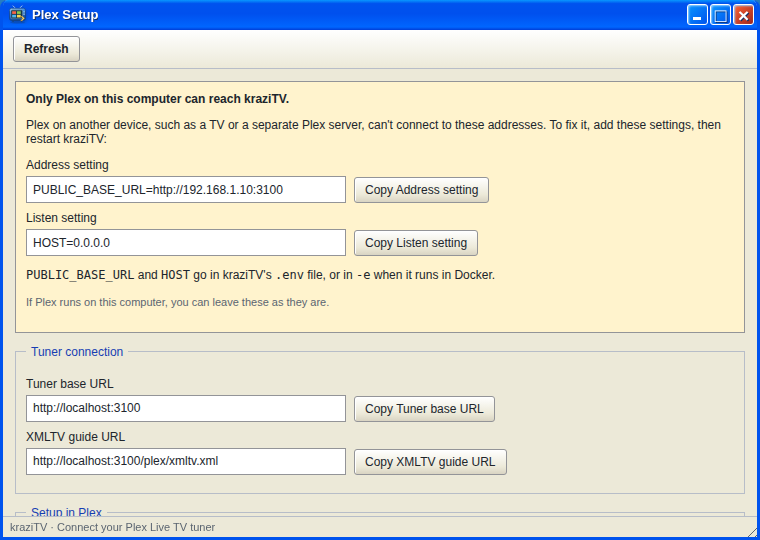

# Connect Plex

kraziTV shows up in Plex as a network TV tuner with its own program guide.
Once connected, your channels appear in Plex **Live TV** on every TV, phone,
and tablet that runs Plex.

## Before you start

Plex needs to reach kraziTV over the network. Open **Plex Setup** on the
desktop. If it shows a yellow warning box, kraziTV is only reachable from the
computer it runs on. The box tells you exactly which settings to add and
where. Add them, restart kraziTV, and come back.

Have at least one channel on the air first; [First run](First-Run) shows
how.

## Add the tuner

1. In Plex Setup, copy the **Tuner base URL**.
2. In Plex, open **Settings**, then **Live TV & DVR**, and choose to set up
   a tuner. Plex may not find kraziTV on its own; choose to enter the
   address manually and paste the tuner base URL.
3. Plex lists the channels it found. Continue.

## Add the guide

1. When Plex asks about guide data, choose to use an XMLTV guide.
2. Paste the **XMLTV guide URL** from Plex Setup.
3. Plex shows each kraziTV channel next to the guide channel it matched.
   Check them and finish.

Plex downloads the guide and then refreshes it on its own schedule, usually
once a day. kraziTV always has the next three days ready.

## Watch

Open **Live TV** in any Plex app and pick a channel. Plex starts playing a
few seconds in, about ten seconds behind the guide, so the picture is ready
the moment you tune in.

Everyone watching a channel shares the same broadcast, so a second viewer
costs nothing extra. Each channel being watched does keep the computer busy
converting video, so a small server comfortably handles a couple of
channels at once.

## If it does not work

- **Plex cannot find or reach the tuner.** The address must be one the Plex
  server can reach. If Plex runs on another machine, `PUBLIC_BASE_URL` must
  be your kraziTV computer's network address. Plex Setup warns you when it
  is not.
- **The guide is empty in Plex.** Plex refreshes the guide on its own
  schedule. In Plex's Live TV & DVR settings you can refresh it by hand.
- **A channel is missing.** Disabled channels are left out of the tuner
  and the guide. A channel added after setup needs Plex to look again; see
  below.
- **Plex says too many tuners are in use.** kraziTV tells Plex it has two
  tuners, so Plex lets you watch two channels at once. Raise
  `KRAZITV_TUNER_COUNT` in [Settings](Settings) if your server can handle
  more.

## Changing channels later

Plex reads the channel list when you set up the tuner, not every time it
changes. After you add, rename, or renumber a channel, open Plex's **Live TV
& DVR** settings, edit the kraziTV tuner, and have Plex scan its channels
again, then check the guide matching. Whatever a channel plays changes in
the guide on its own, as Plex refreshes it.

## Removing it

To take kraziTV out of Plex, remove the kraziTV tuner in **Live TV & DVR**.
Do the same, then set it up again, if `PUBLIC_BASE_URL` ever changes, since
Plex remembers the old address.

---

**Next:** [The desktop](The-Desktop) shows you around the web app, or jump
to [My Channels](My-Channels) to build out your lineup.
