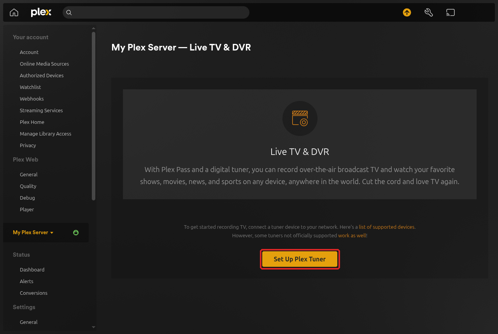
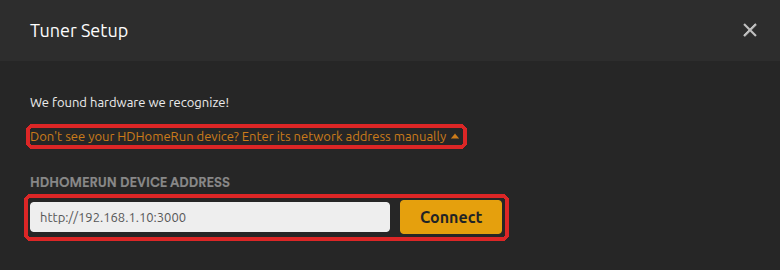
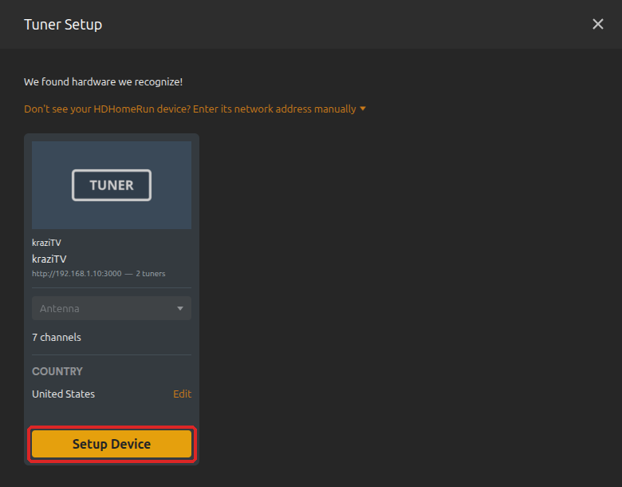
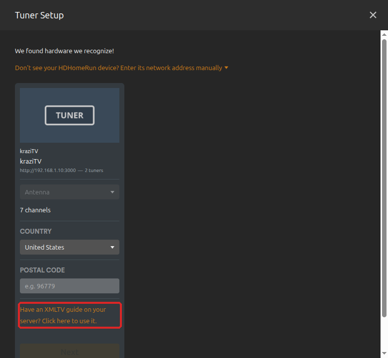
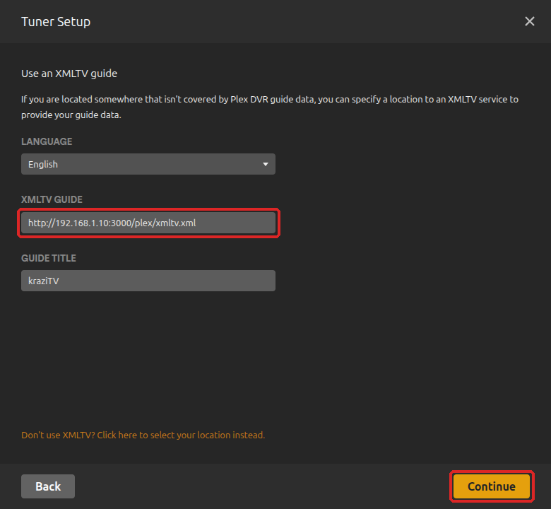
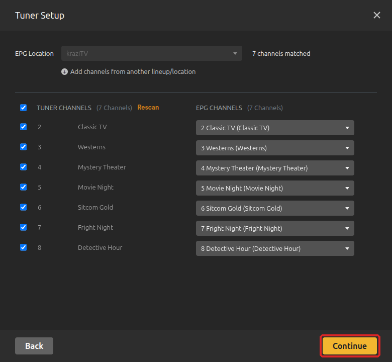
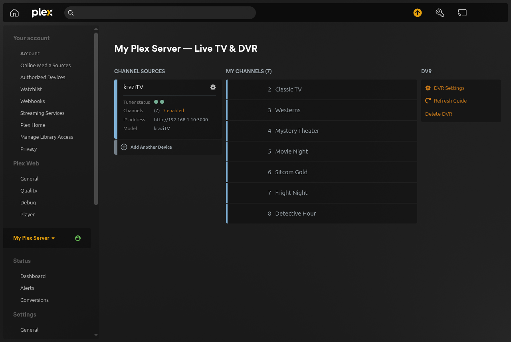

# Connect Plex

kraziTV shows up in Plex as a network TV tuner with its own program guide.
Once connected, your channels appear in Plex **Live TV** on every TV, phone,
and tablet that runs Plex.

## Before you start

Plex needs to reach kraziTV over the network. Open **Plex Setup** on the
desktop. If it shows a yellow warning box, kraziTV is only reachable from the
computer it runs on. The box tells you which settings to add and where.
When kraziTV runs in Docker it cannot see your computer's network address,
so the box leaves a blank for it and links to
[Your address](Install#your-address), which shows how to find it. Add the
settings, restart kraziTV, and come back.

Have at least one channel on the air first; [First run](First-Run) shows
how.

## Add the tuner

Keep Plex Setup open: you will copy its **Tuner base URL** and **XMLTV
guide URL** into Plex. These steps use Plex in a web browser; open it from
[app.plex.tv](https://app.plex.tv) or your Plex server's address.

1. In Plex, click the **Settings** wrench at the top right. In the list on
   the left, under your server's name, click **Live TV & DVR**, then
   **Set Up Plex Tuner**.

   

2. Plex looks for tuners on your network. It usually does not find kraziTV
   on its own. Click **Don't see your HDHomeRun device? Enter its network
   address manually**, paste the **Tuner base URL**, and click **Connect**.

   

3. A **kraziTV** card appears with the number of channels it found. Click
   **Setup Device**.

   

## Add the guide

4. Plex asks for a country and postal code for its own guide. Skip them and
   click **Have an XMLTV guide on your server? Click here to use it.**

   

5. Paste the **XMLTV guide URL** into **XMLTV Guide**. Leave **Language**
   on yours, give the guide a title such as `kraziTV` under **Guide Title**,
   and click **Continue**.

   

6. Plex lists each kraziTV channel next to the guide channel it matched.
   kraziTV names them the same way, so they all match on their own. Click
   **Continue**.

   

7. Plex says **Setup complete**. Click **Close**. Live TV & DVR now lists
   kraziTV under **Channel Sources** and your channels under **My
   Channels**.

   

Plex downloads the guide and then refreshes it on its own schedule, usually
once a day. kraziTV always has the next three days ready.

## Watch

Open **Live TV** in any Plex app and pick a channel. Plex starts playing a
few seconds in, about ten seconds behind the guide, so the picture is ready
the moment you tune in.

Everyone watching a channel shares the same broadcast, so a second viewer
costs nothing extra. Each channel being watched does keep the computer busy
converting video, so a small server comfortably handles a couple of
channels at once.

## If it does not work

- **Plex cannot find or reach the tuner.** The address must be one the Plex
  server can reach. If Plex runs on another machine, `PUBLIC_BASE_URL` must
  be your kraziTV computer's network address. Plex Setup warns you when it
  is not.
- **The guide is empty in Plex.** Plex refreshes the guide on its own
  schedule. In Plex's Live TV & DVR settings you can refresh it by hand.
- **A channel is missing.** Disabled channels are left out of the tuner
  and the guide. A channel added after setup needs Plex to look again; see
  below.
- **The kraziTV card is greyed out and says "You can add this device
  later".** Plex found another tuner too, such as a TV tuner card or an
  HDHomeRun, and sets up only that one. Plex offers no way to pick
  kraziTV instead. Set up kraziTV while Plex cannot see the other tuner:
  unplug it, or remove it from Plex's Docker container, and restart Plex.
  Once kraziTV is set up, put the other tuner back; kraziTV stays.
- **Plex says too many tuners are in use.** kraziTV tells Plex it has two
  tuners, so Plex lets you watch two channels at once. Raise
  `KRAZITV_TUNER_COUNT` in [Settings](Settings) if your server can handle
  more.

## Changing channels later

Plex reads the channel list when you set up the tuner, not every time it
changes. After you add, rename, or renumber a channel, open Plex's **Live TV
& DVR** settings and click the **enabled** count next to **Channels** under
kraziTV, such as **7 enabled**. In **Channel Matching**, click **Rescan**,
check the matches, and click **Save**. Whatever a channel plays changes in
the guide on its own, as Plex refreshes it; **Refresh Guide** fetches it
right away.

## Removing it

To take kraziTV out of Plex, click **Delete DVR** in **Live TV & DVR**.
Do the same, then set it up again, if `PUBLIC_BASE_URL` ever changes, since
Plex remembers the old address.

---

**Next:** [The desktop](The-Desktop) shows you around the web app, or jump
to [My Channels](My-Channels) to build out your lineup.
