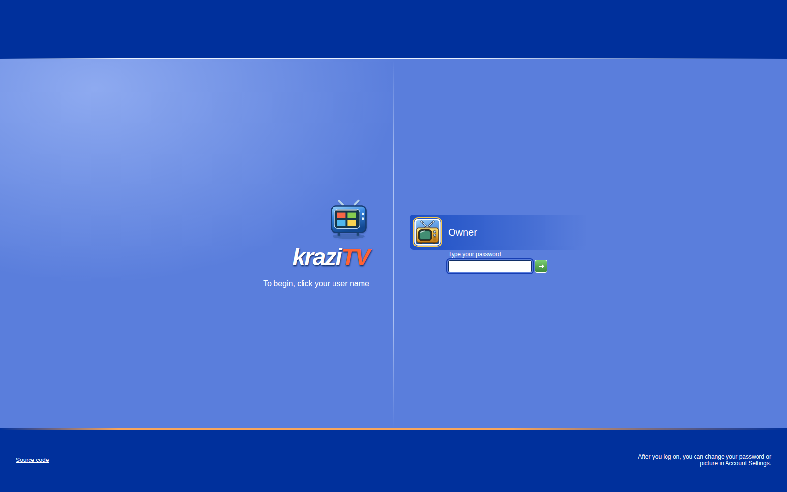
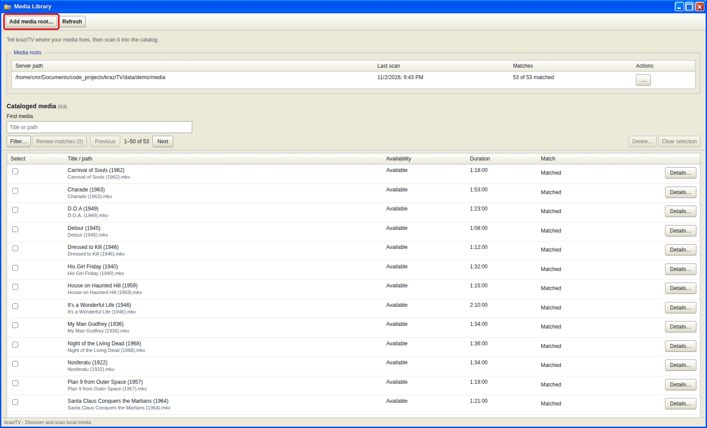
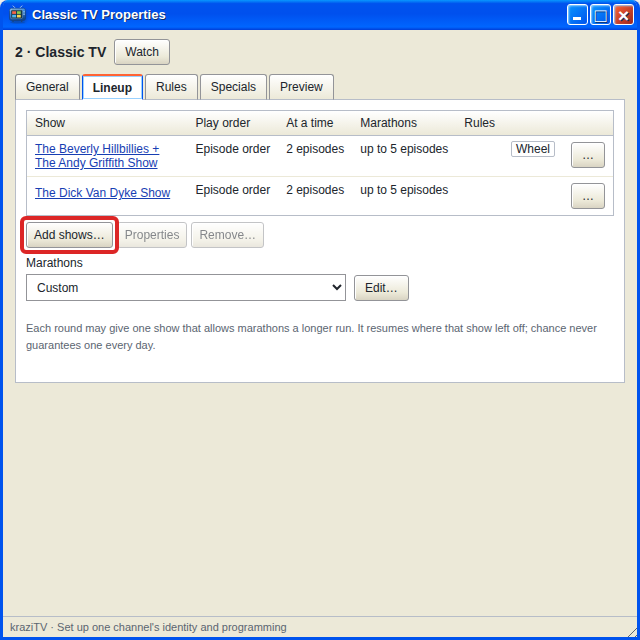

# First run

This walk-through takes you from the welcome screen to a channel you can
watch. It takes a few minutes plus however long your first scan runs.

## 1. Create your account

The first time you open kraziTV it asks for a name and a password, typed
twice. kraziTV has exactly one account, and this is it. Pick a password of at least eight
characters and click **Next**.

From then on, kraziTV greets you with a logon screen. Click your name and
type your password.

## 2. Add your media

Open **Media Library** from the desktop. Click **Add media root…** and type
the folder that holds your media, as the kraziTV computer sees it. In Docker
that is `/media`, or the folder under it you gave each drive in
[Install](Install#your-media-folders). **Browse…** lets you pick the folder instead of typing it.

When you click **Add root**, kraziTV offers to scan the folder right away.
Click **Scan**. A scan reads every video file under the folder and adds it to the
catalog. A large library can take a while; you can close the window and come
back.

If your shows and movies are organized the way Plex likes, one media root for
all of them is fine. Several roots work just as well, such as one for TV and
one for movies.

## 3. Set up TMDB

A yellow icon in the system tray reminds you that TMDB is not set up. With
a free TMDB key, kraziTV recognizes your series, seasons, episodes, and
movies, and can build collections for you. Without it, kraziTV only knows
what your file names say.

[Set it up](Set-Up-TMDB) now, then scan each media root
again from its row menu. The rescan only looks up files that were never
matched, so it is quick. [Media Library](Media-Library) explains what the lookups find.

## 4. Keep some collections

Open **Collections** and click **Discover collections…**. kraziTV
suggests one collection per series and movie franchise it recognized.
Click **Create automatic collection** on the ones you want. An automatic
collection keeps itself up to date as you add files.

You can skip this step: a channel can also play a single series or movie
you pick directly. But collections are what make channels easy to build.

## 5. Create a channel

Open **My Channels** and click **New channel…**. Give it a number, such as
`5`, and a name, and click **Create channel**. The channel's **Properties**
window opens on its **Lineup** tab, ready for shows.

Click **Add shows…**, tick a few collections, and click **Next**. For each
one, choose how it plays and how much plays at a time. kraziTV suggests
three episodes for a series and one movie for a movie collection, which
are fine to start with; a collection that mixes the two needs your choice.
Click **Add**. Both buttons count your picks.

That is it. The channel is on the air, taking turns between its shows.

## 6. Watch it

Click **Watch** at the top of the channel's Properties window to see it in
**TV**, right in the browser. Or open **Program Guide** to see what the
channel will air today, and click the channel's name there.

---

**Next:** [Connect Plex](Connect-Plex), or go deeper into the programs with
[Media Library](Media-Library).
