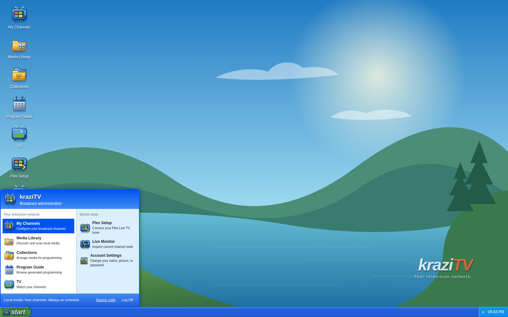

# Welcome to kraziTV

kraziTV turns the movies and shows you already own into television channels.
Each channel broadcasts around the clock, whether or not anyone is watching.
Tune in and you land partway through whatever is on, just like real TV.

You set channels up once, in a web app that looks like Windows XP, and
kraziTV keeps programming them for as long as it runs. Watch in Plex, on any
device Plex runs on, or in the browser.

## Start here

New to kraziTV? Read these in order. Each page ends by pointing to the next.

1. [Install](Install): run kraziTV with Docker or from source.
2. [First run](First-Run): create your account, scan your media, and put a
   channel on the air in a few minutes.
3. [Connect Plex](Connect-Plex): make your channels show up in Plex Live TV.

## The programs

The desktop has eight programs; [The desktop](The-Desktop) shows you
around. Four of them are where you spend your time:

| Program                        | What you do there                               |
| ------------------------------ | ----------------------------------------------- |
| [Media Library](Media-Library) | Tell kraziTV where your files are and scan them |
| [Collections](Collections)     | Group media into sets a channel can play        |
| [My Channels](My-Channels)     | Create channels and decide what they play       |
| [Program Guide](Program-Guide) | See what every channel airs over the next day   |

The others are [TV](TV), [Plex Setup](Connect-Plex),
[Live Monitor](Live-Monitor), and [Account Settings](Account-Settings).

## Going further

Once a channel is on the air, these pages explain the ideas behind it:

- [How programming works](How-Programming-Works): rounds, turns, and why
  every show gets its fair share.
- [Play order](Play-Order): episode order, release order, your order, or
  random.
- [Wheels](Wheels): several shows sharing one spot in the rotation.
- [Marathons](Marathons): letting a show run long now and then.
- [Rules](Rules): different programming on certain days, dates, or hours.
- [Specials](Specials): something exact at an exact time.
- [Off air and other screens](Off-Air): what viewers see when no program is
  on.

[Scenarios](Scenarios) walks through common setups, such as Christmas
movies in December, a Friday movie night, or taking over a channel for a day.
For reference, [Naming your files](Naming-Your-Files) gets you better TMDB
matches and [Settings](Settings) lists every option.

## Something wrong?

Try [Troubleshooting](Troubleshooting). If that does not help,
[open an issue](https://github.com/ridloncmr/kraziTV/issues).
