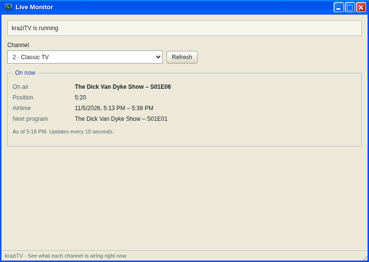

# Live Monitor

Live Monitor, which the desktop and Start describe as **See what each
channel is airing right now**, answers one question: what is this channel
doing right now? It shows what is on the air, how far into it the channel
is, when it ends, and what follows, and refreshes every ten seconds.

Live Monitor opens on the channel you chose in it last time, or on your
first enabled channel the first time. Pick another from **Channel** to check
it; the next time you open Live Monitor, it starts there.

It is the quickest way to check a channel without tuning in. If the channel
is off the air, it says so and suggests where to look. See
[Troubleshooting](Troubleshooting).

The status line at the top says whether the browser can reach kraziTV at
all.

---

**Next:** [Account Settings](Account-Settings).
