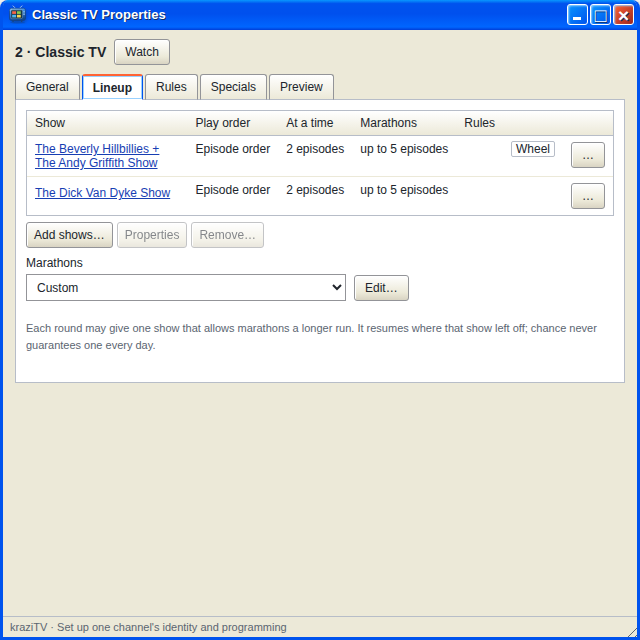

# Marathons

A marathon is a turn that runs long. Now and then, instead of its usual
three episodes, a show gets a longer run, then the round continues as
normal. It is how real channels fill a lazy Sunday with six hours of one
show.

Marathons are off until you turn them on, in two places. Only shows that
play a collection can run long; a single file always plays once.

## On the show

Open a show's Properties and tick **Allow marathons**. By default a
marathon is twice the show's usual count, or three times its usual time:
three episodes become six, about an hour becomes about three. Tick
**Choose the marathon length** to set your own. It must be longer than the
usual amount and measured the same way, programs or minutes. Until it is,
OK and Apply stay off and the sheet says what to change.

A marathon continues from where the show left off. It never starts the
series over.

## On the channel

Under the Lineup table, **Marathons** sets how often the channel rolls for
one. It stays greyed out until at least one show allows marathons:

| Setting        | Chance each round | Ordinary rounds in between |
| -------------- | ----------------- | -------------------------- |
| **Off**        | Never             |                            |
| **Occasional** | 1 in 10           | 2                          |
| **Frequent**   | 1 in 4            | 1                          |
| **Custom…**    | Your chance       | Your gap                   |

At the start of each round, if the gap has passed, kraziTV rolls once. If
the roll succeeds, one show that allows marathons is picked at random and
its turn in that round becomes a marathon. At most one marathon happens per
round, and a chance is a chance: Occasional does not promise one a day.

## Marathons and rules

A [rule](Rules) can change a show's marathon setting while the rule
applies: keep the lineup's setting, allow none, or set a different length.
A Halloween rule, for instance, can give a horror series longer marathons
all October.

---

**Next:** [Rules](Rules).
