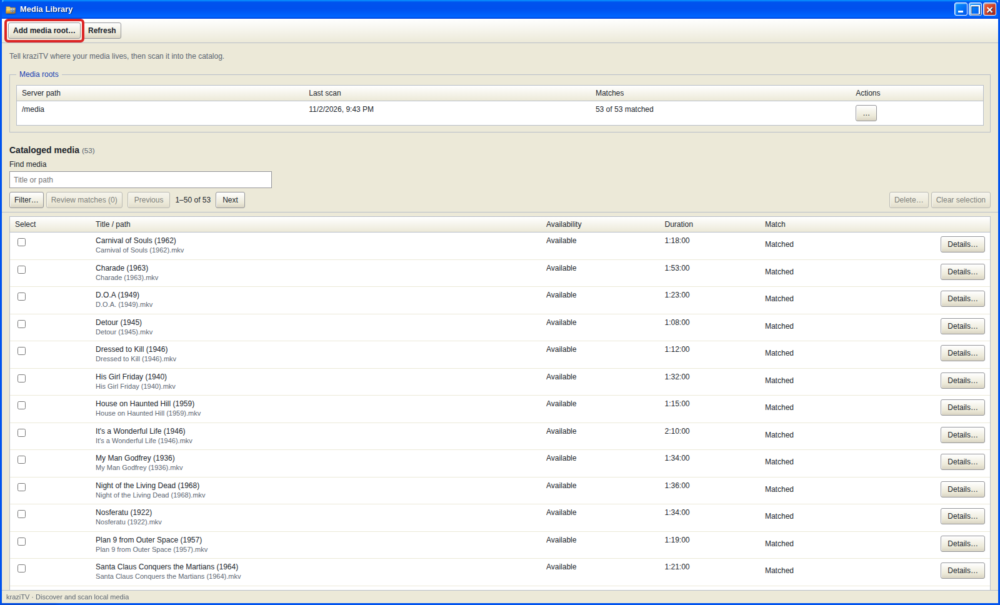
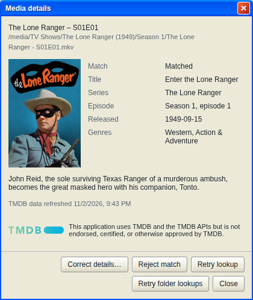
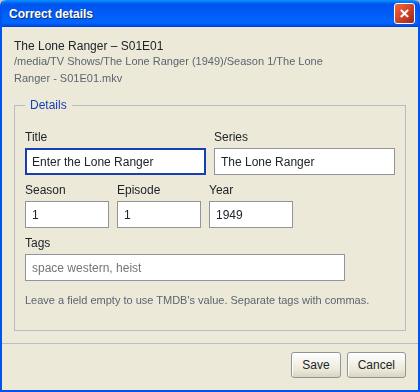

# Media Library

Media Library is where you tell kraziTV where your files are and let it
build a catalog of them. Everything else, collections and channels alike,
draws from that catalog.

## Media roots

A media root is a folder kraziTV scans for video files. You can add as many
as you like: one for everything, or one each for movies, TV, and cartoons.
Overlapping roots catalog the same files twice, so keep them separate.

Click **Add media root…**, type the folder's path as the kraziTV computer
sees it, or use **Browse…** to find it. In Docker your media is under `/media`, as you set up in
[Install](Install#your-media-folders).
After you click **Add root**, kraziTV offers to scan the folder straight
away. A root you choose not to scan keeps a **Scan** button in its row until
you do.

Each root's row shows when it was last scanned and how many of its files
were matched on TMDB. The row menu holds the rest:

- **Scan** reads the folder again and picks up new, changed, and missing
  files.
- **Retry failed lookups** asks TMDB again about files it could not look up
  last time.
- **Disable** stops scans and background refreshes for that root. Its files
  stay in the catalog.
- **Delete…** removes the root and all of its files from the catalog. The
  files on disk are untouched.

A root's path cannot be edited. To move one, delete it and add the new path.

## Scanning

A scan finds every video file under the root, reads each one to learn how
long it is and what audio and video it has, and looks up the ones TMDB has
not answered yet. A progress dialog
shows each step. You can close the window; the scan keeps running, and
Media Library reattaches to it when you come back.

kraziTV recognizes `.mkv`, `.mp4`, `.m4v`, `.avi`, `.mov`, `.ts`, and
`.webm` files. It skips hidden folders and does not follow folder links.

A scan is all or nothing. If it fails or you cancel it, the catalog stays
exactly as it was.

Scanning again is quick. Files already matched, rejected, awaiting your
choice, or corrected are never looked up again, so your matches and
corrections survive every scan. Only files still **Unmatched** or **Lookup
failed** are asked about again. A file that has disappeared is marked
**Missing** and stops airing until it returns. A file kraziTV cannot open
is marked **Could not be read**, and a file shorter than a second counts as
too short; neither airs. A file that moved or was renamed counts as a new
file.

## Matching on TMDB

With a TMDB key set up, kraziTV works out what each file is from its name
and the folders around it, then confirms it on TMDB. [Naming your
files](Naming-Your-Files) shows the layout that matches best. Until a key
is saved, the line at the top of Media Library ends with **Set up TMDB…**,
which opens [Account Settings](Account-Settings) on that task.

The **Match** column says how each file came out:

| Label                                   | Meaning                                                        |
| --------------------------------------- | -------------------------------------------------------------- |
| **Matched**                             | kraziTV knows what it is                                       |
| **Matched; episode not listed on TMDB** | The series matched, but TMDB does not list this episode number |
| **Needs your choice**                   | More than one title fits, so kraziTV would rather ask          |
| **Unmatched**                           | TMDB had nothing that fits                                     |
| **Lookup failed**                       | TMDB could not be reached or rejected your key; Details says   |
| **Rejected**                            | You said the match was wrong                                   |
| **Not looked up**                       | No TMDB key, or not searched yet                               |
| **Extra**                               | Bonus material, such as a featurette, which is never looked up |
| **File changed**                        | The file's length changed since it was matched                 |

kraziTV only matches on its own when exactly one answer makes sense. A show
with two versions, such as a remake, gets **Needs your choice** unless the
folder name includes the year or your seasons fit only one of them. One
choice settles every episode under that show's folder, so a whole series is
one question, not forty.

**Review matches (n)** at the top of the catalog walks you through every
open question, one show or movie at a time. Each step shows the candidates
with their posters and lets you search TMDB for something else.

## Details

**Details…** on any row opens everything kraziTV knows about the file: its
match, title, series, episode, release date, genres, and TMDB's description.
A file marked **Could not be read** says so here under **Why**, and a lookup
that failed says whether TMDB could not be reached, which kraziTV retries on
its own, or rejected your key, which you check in Account Settings; the row
itself only names the state.

From here you can:

- **Correct details…** to set the title, series, season, episode, or year
  yourself. Your values win over TMDB's and survive every scan. Leave a
  field empty to go back to TMDB's value.
- **Choose match…** when the file needs your choice.
- **Reject match** when TMDB got it wrong. Scans will not match it again
  until you **Clear rejection**.
- **Retry lookup** for this file, or **Retry folder lookups** for everything
  in its folder.
- **Map tracks to episodes…** for disc rips with names like `t_00.mkv` or
  `title_t00.mkv`, which kraziTV cannot identify on its own. You pick the series and season,
  and kraziTV lines the tracks up with the episodes.

Corrections apply to one file and stop it being looked up again. Choosing
a match applies to the whole show folder.

## Tags

Tags are your own labels, such as `Christmas` or `Rainy day`. Add them in
**Correct details…**, separated by commas. Capitalization does not matter;
`christmas` and `Christmas` are the same tag.

Tagging a file does nothing on its own. The point of tags is
[Collections](Collections): an automatic collection built from a tag keeps
every file carrying it, which is how you build a Christmas collection out of
episodes from twenty different shows.

## Finding things

**Find media** searches titles and paths. **Filter…** narrows the list by
match state, type, availability, series, franchise, genre, tag, root, or
details such as files you corrected or files in no collection.
Filters combine: tick two series to see both, tick a series and **Missing**
to see which of its files are gone.

## Deleting media

Select rows and click **Delete…**, or delete a whole root from its row
menu. Deleted media leaves every collection and every channel's upcoming
schedule at once. The files on disk are never touched.

If something you are deleting is on the air right now, kraziTV asks whether
to let it finish or stop it now. If a channel would be left with nothing to
play, it says so before you confirm. A file that a show plays directly, or
that a special uses, cannot be deleted until you change that first.

A deleted file whose path still exists comes back on the next scan of its
root. To keep files out for good, move them out of the root.

## Keeping TMDB data fresh

TMDB asks that its data not be kept longer than six months. kraziTV refreshes
each title's facts in the background once they are five months old. If TMDB
cannot be reached for a long time, the title, description, genres, dates,
and poster expire until a refresh succeeds, but the match, the episode
numbers, and your corrections stay.

---

**Next:** [Naming your files](Naming-Your-Files) if your matches need work,
otherwise [Collections](Collections).
