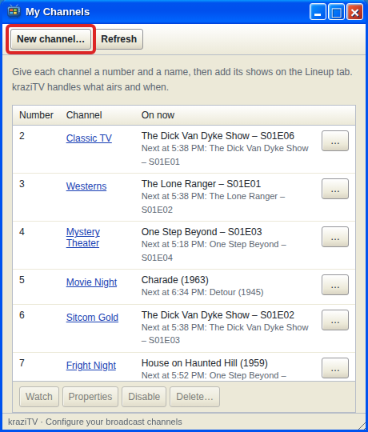
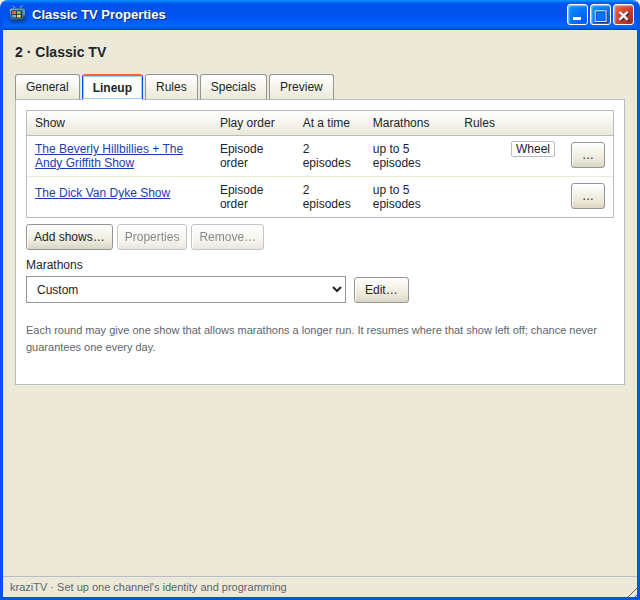
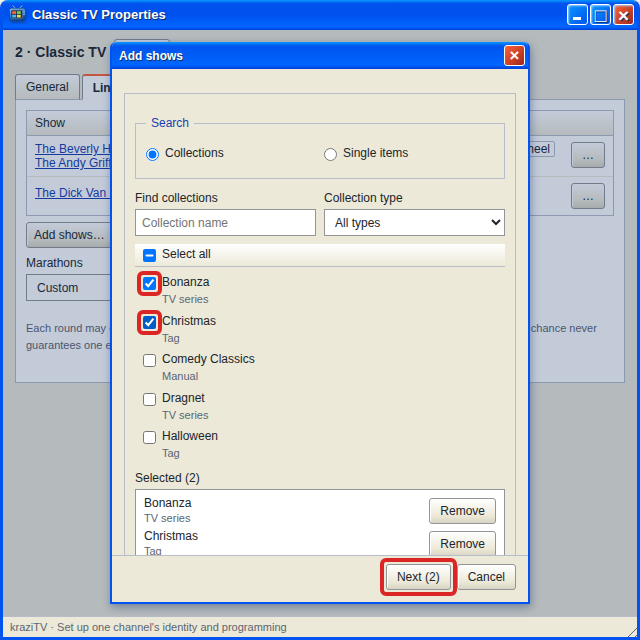
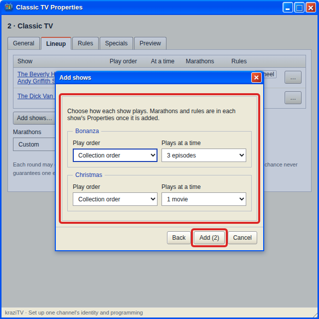
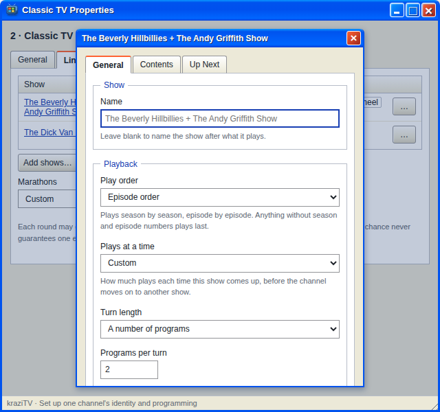
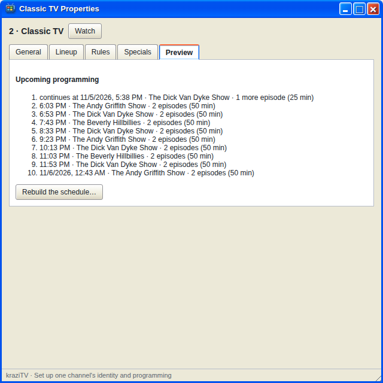

# My Channels

My Channels is where you create channels and decide what they play. A
channel is a number, a name, and a lineup of shows. kraziTV takes turns
between the shows around the clock, so you never schedule anything by hand.

The list shows every channel with what it is airing now and what comes
next. Double-click a channel, or select it and click **Properties**, to
open its own window. The row menu and the buttons underneath also offer
**Watch**, which opens it in [TV](TV), **Disable**, and **Delete…**.

Disabling a channel stops its broadcast and takes it out of Plex, but keeps
everything you set up. Enable it again and it picks up from now. Deleting
a channel removes its lineup, rules, and specials for good. Collections and
files are never touched.

## Creating a channel

Click **New channel…**. A channel needs a number and a name. Numbers can
have a subchannel, so `5` and `5.1` are both fine, and Plex sorts the guide
by them. The new channel's Properties window opens on its Lineup tab, ready
for shows.

## Channel Properties

Each channel has its own window with five tabs.

| Tab          | What it holds                                                              |
| ------------ | -------------------------------------------------------------------------- |
| **General**  | The number and name                                                        |
| **Lineup**   | The shows the channel takes turns between, and its marathon setting        |
| **Rules**    | Different programming on certain days, dates, or hours. See [Rules](Rules) |
| **Specials** | Something exact at an exact time. See [Specials](Specials)                 |
| **Preview**  | The next turns as kraziTV would play them                                  |

Rules and Preview appear once the lineup has at least one show. You can
change a channel's number or name on General at any time without disturbing
what is airing.

## The Lineup tab

A show is one row in the lineup. It plays one collection or one file.
Each time the show's turn comes around, it plays a set amount, then the
channel moves on to the next show. A show with several collections is a
[wheel](Wheels).

Click **Add shows…**, tick collections, or switch to **Single items** to
pick individual episodes or movies, and click **Next**.

Then choose, for each one:

- **Play order**: the order the show goes through its collection. See
  [Play order](Play-Order).
- **Plays at a time**: how much airs each turn, as a number of programs or
  an amount of time. kraziTV suggests three episodes for a series and one
  movie for a movie collection. **Custom…** lets you set any count, any
  number of minutes, or a range.

Time amounts are targets, not limits: a turn plays whole programs until it
passes the target, and a long movie always airs whole. [How programming
works](How-Programming-Works#what-a-turn-will-not-do) explains why.

Each show's own **Properties** dialog has these settings plus a few more:

- A **Name**, if you want one other than the collection's.
- **Allow marathons**: now and then this show gets a longer run. See
  [Marathons](Marathons).
- **Only air when a rule picks it**: keep the show out of the regular
  rotation. See [Rules](Rules).
- A **Contents** tab for changing what the show plays, and an **Up Next**
  tab showing the collection in its play order and the next ten programs
  it will air on this channel.

A collection or file can be in only one show per channel. **Remove…** takes
a show off the lineup; whatever is airing finishes, and the show gets no
new turns.

The order of shows in the lineup does not matter. kraziTV shuffles the
turns each round so no show always follows another. [How programming
works](How-Programming-Works) explains the rotation.

Below the table, **Marathons** sets how often the channel lets a show run
long: **Off**, **Occasional**, **Frequent**, or a custom chance. It stays
greyed out until a show allows marathons.

## Changing a channel on the air

Every change applies as soon as you save it. Whatever is airing right now
always finishes; kraziTV rebuilds the schedule after it. If a program is
on the air when you save, it asks what to do:

- **Let it finish** is the default and disturbs no one.
- **Stop it now and start the new lineup** cuts the program. Viewers are
  disconnected and have to tune in again.

The same choice is on the Preview tab as **Rebuild the schedule…**, for
when you want a fresh start without changing anything.

## The Preview tab

Preview lists the next ten or so turns in order, with each show, how much
it plays, and how long that takes. A turn already on the air reads
**continues at** the time its next program starts, with what it has left,
such as "1 more episode". When rules are involved it says which rule chose
each turn. A show that cannot air, because its collection is
empty or its files are missing, is listed as skipped with the reason. When
nothing at all would air, as on a channel whose only shows wait for a rule,
Preview says so and points at the Lineup and Rules tabs instead of showing
an empty list.

---

**Next:** [Program Guide](Program-Guide) to see the result, or [How
programming works](How-Programming-Works) to understand it.
