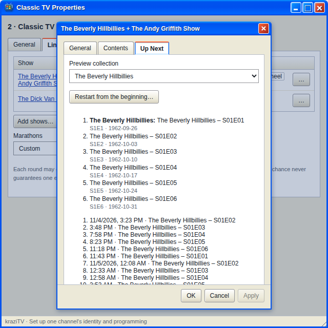

# Play order

Every show that plays a collection has a play order: how it goes through
the collection, turn after turn. You pick it when you add the show and can
change it in the show's Properties.

| Play order           | What it does                                                                                  |
| -------------------- | --------------------------------------------------------------------------------------------- |
| **Collection order** | Top to bottom, as the collection is saved. Best for manual collections you arranged yourself. |
| **Episode order**    | Season by season, episode by episode. Specials (season 0) come first.                         |
| **Release order**    | Oldest first, by release or air date. The natural choice for movie franchises.                |
| **Random**           | A random pick each time. Things can repeat.                                                   |

Episode and release order need season and episode numbers or a release
date, from TMDB or your own corrections. A file without them plays after
everything else. Open the
show's **Up Next** tab to see the order kraziTV will use, with anything it
could not place flagged.

The play order belongs to the channel, not the collection. One channel can
play a series in episode order while another plays it at random, and
neither changes the collection itself.

## Where a show is up to

A show continues from where it left off each turn. Change its play order
and it starts keeping a separate place for the new order; switch back and
the old place is still there.

**Random** is not truly random: kraziTV draws each pick from a fixed
sequence for that channel and collection, until you reshuffle it, so the
Up Next tab can show you the upcoming picks. Its **Reshuffle…** starts the
picks over in a new order; see below.

## Starting over

In the show's Properties, on the **Up Next** tab, **Restart from the
beginning…** sends the collection back to its first program on this
channel. On a **Random** show the button reads **Reshuffle…** and starts
the random picks over in a new order instead; each reshuffle gives another
new order. The button appears once the play order shown is the saved one.
Whatever is airing finishes first. Only that collection in that play order
on that channel is affected.

---

**Next:** [Wheels](Wheels).
