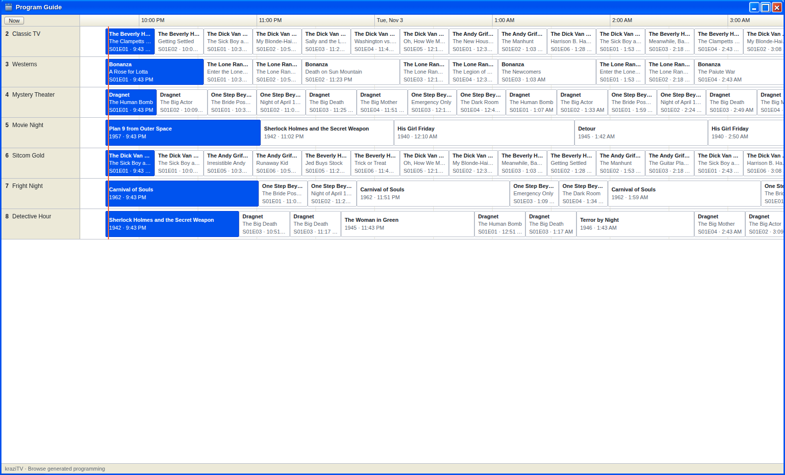
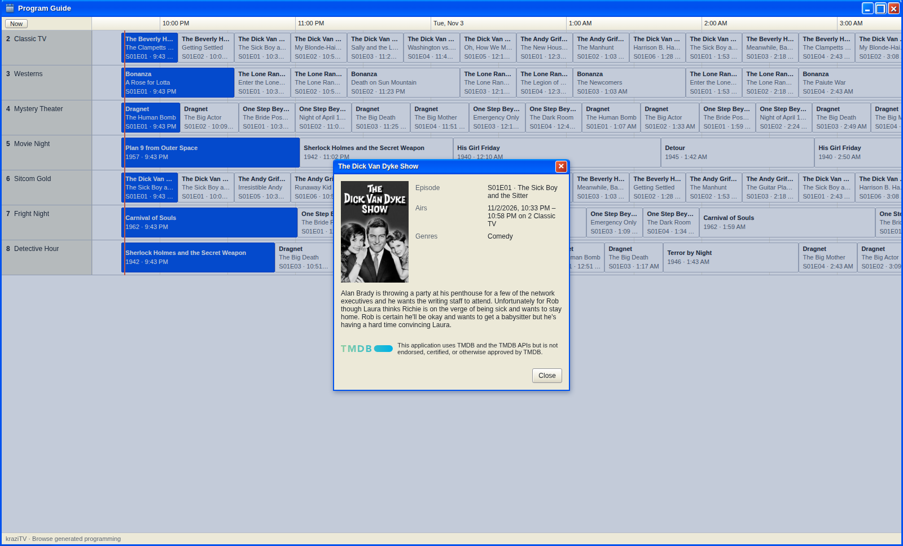

# Program Guide

The Program Guide shows what every channel airs over the next 24 hours, in
a grid like a cable guide. It starts at the current half hour and the orange
line marks now.

- **Click a program** to see its details: episode, air time, genres, poster,
  and description.

  

- **Click a channel's name** to watch it in [TV](TV). A disabled channel
  is marked **Disabled** and cannot be clicked.
- **Now** jumps back to the current time after you have scrolled ahead.

The program on the air is highlighted. A block reading **Off air** is time
no program fills; [Off air and other screens](Off-Air) explains when that
happens.

Times are shown in your browser's timezone. The guide reads the schedule
when you bring its window to the front, so after changing a channel, click
the guide to see the result.

Plex gets the same schedule through its own guide, three days ahead. See
[Connect Plex](Connect-Plex).

---

**Next:** [TV](TV), to watch what the guide shows.
