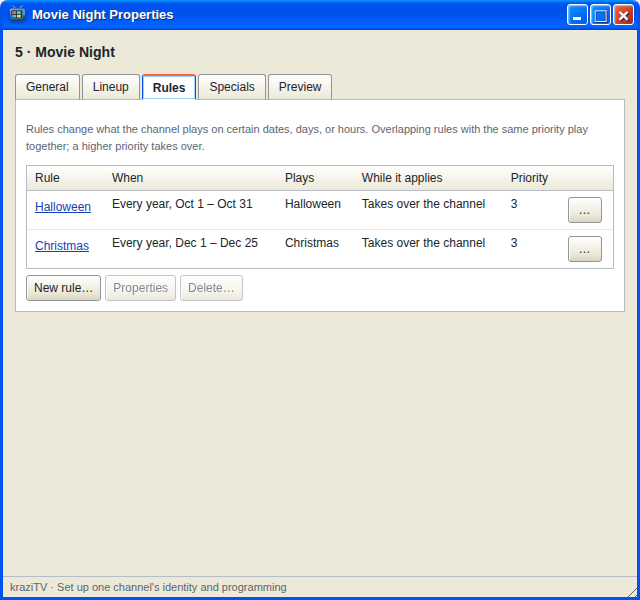
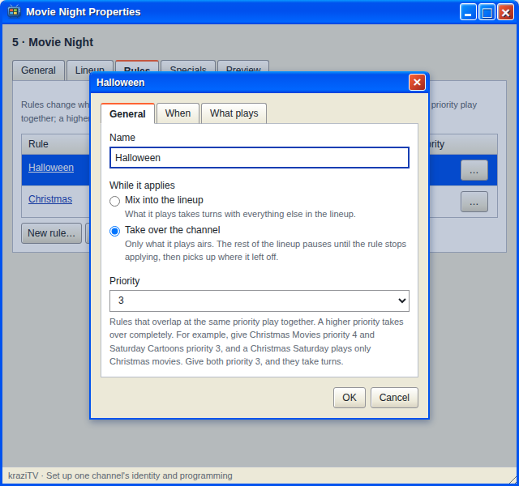
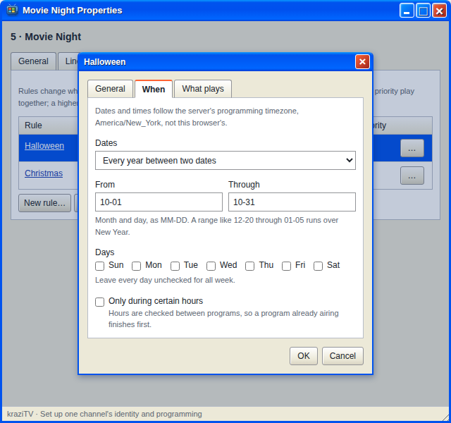
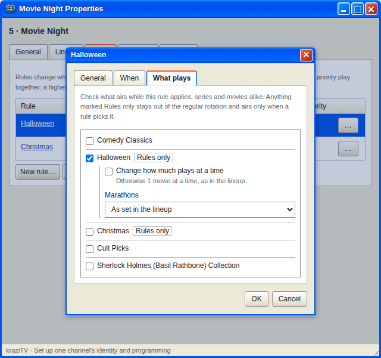

# Rules

A rule changes what a channel plays on certain dates, days, or hours.
Cartoons on Saturday mornings, horror all October, late-night shows after
8 PM. Outside those times the channel plays its regular lineup.

Rules live on the **Rules** tab of a channel's Properties, and they only
ever pick from shows on that channel's lineup.

## Making a rule

Click **New rule…**. The dialog has three tabs.

**General** gives the rule a name and says what it does while it applies:

- **Mix into the lineup**: the rule's shows take turns alongside everything
  else. Christmas movies join the regular rotation in December.
- **Take over the channel**: only the rule's shows air. The rest of the
  lineup pauses and picks up where it left off when the rule stops.

**Priority** runs from **1 (lowest)** to **5 (highest)** and starts at 3.
It matters only when rules overlap. See [When two rules
overlap](Scenario-Rules-Overlap).

**When** sets the conditions. All of them must hold, and leaving one empty
means it does not limit the rule.

- **Dates**: any date, a one-off range, or a range that repeats every year.
  A yearly range like `12-20` through `01-05` runs over New Year.
- **Days**: tick the days of the week. None ticked means every day.
- **Only during certain hours**: a start and end time. Hours that end
  before they start run past midnight and count as the day they began, so
  a Friday 8 PM to 2 AM rule covers early Saturday morning.

Dates and times follow kraziTV's programming timezone, which the dialog
names. See [Settings](Settings#the-timezone) if it is not yours.

**What plays** lists the lineup's shows. Tick the ones the rule picks. For
each one you can change how much plays at a time, and set its
[marathons](Marathons) to **As set in the lineup**, **None while this rule
applies**, or **Choose a marathon length**, for as long as the rule
applies.

## Shows that only air under a rule

Most rule shows also play in the regular rotation. If a show should never
air except when a rule picks it, open the show's Properties and tick **Only
air when a rule picks it**. The lineup marks it **Rules only**. A Christmas
collection is the classic case: on the lineup all year, on the air only in
December.

Keep at least one regular show in every lineup. A channel with only
rules-only shows has nothing to play outside its rules.

## Timing

Rules are checked between programs, never during one. That has two
consequences you will notice:

- The first program under a rule starts at the first program boundary
  after the rule begins, not on the dot. If a movie starts at 7:40 PM, an
  8 PM rule waits for it.
- The last program can start just before the rule ends and run past it.
  After that, no new programs under the rule start.

If something must start at an exact time, use a [special](Specials).

## Changing rules

Select a rule and click **Properties** to edit it or **Delete…** to remove
it. Either takes effect after whatever is airing. If a program is on the
air, kraziTV asks whether to let it finish or stop it now, as with any
lineup change. Rules have no on/off switch; to pause one, delete it or give
it a one-off date range in the past.

The **Preview** tab lists the channel's next ten turns and says which rule
chose each, so a rule that starts within them can be checked. A rule weeks
away shows up once its day is near.

---

**Next:** [Specials](Specials), or see rules in action in
[Scenarios](Scenarios).
