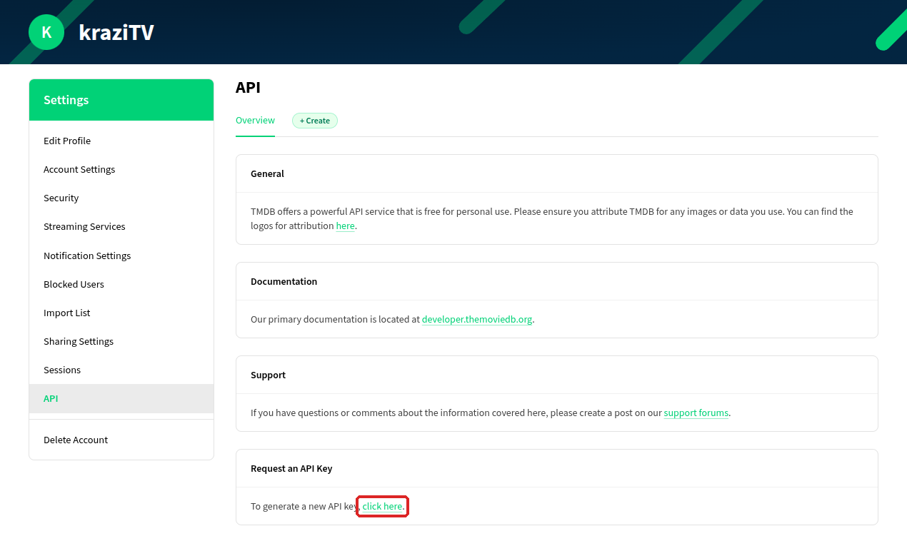
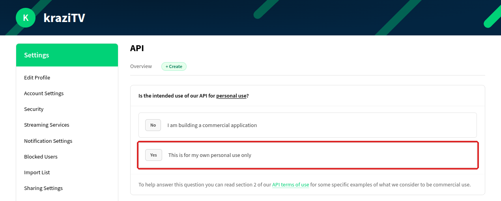
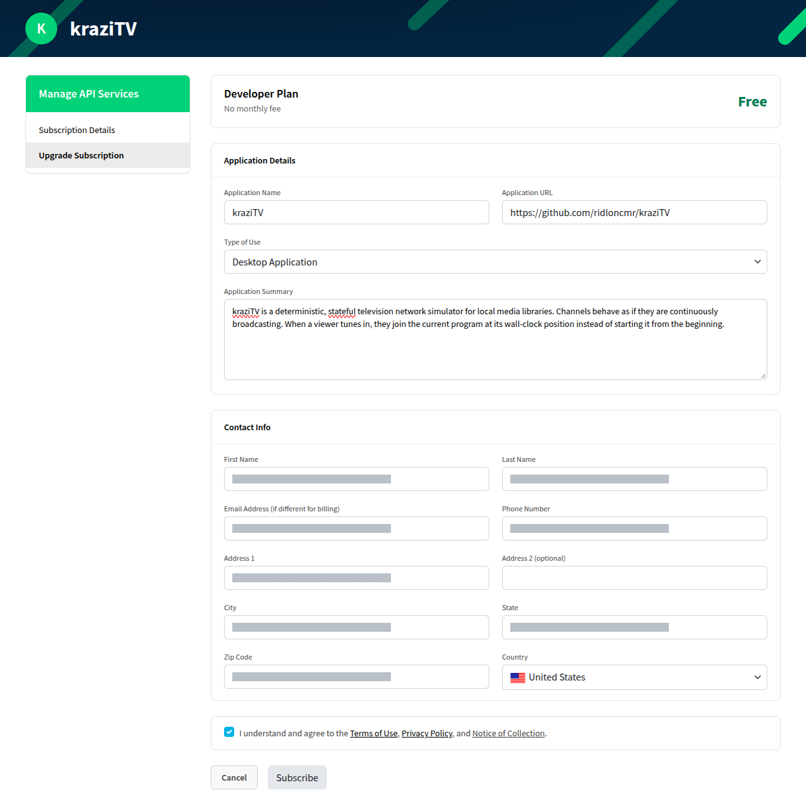
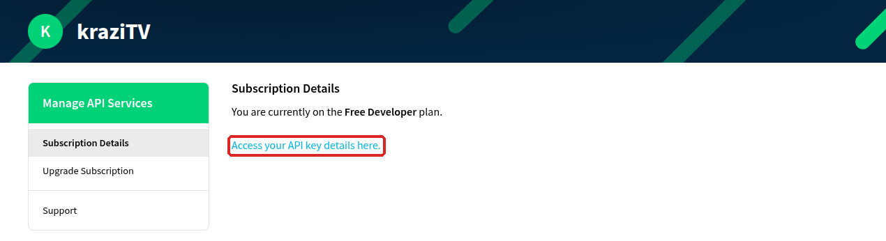
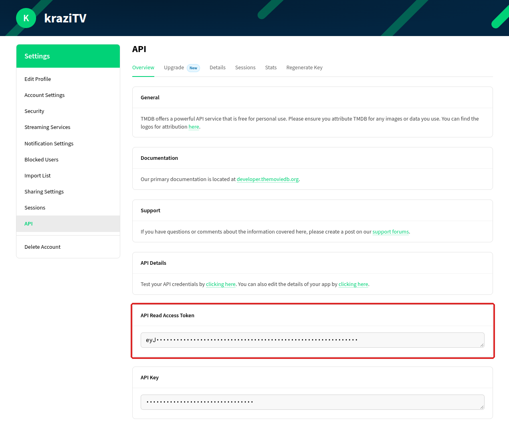
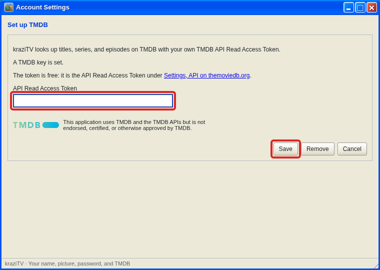

# Set up TMDB

TMDB is the free database kraziTV uses to recognize your shows and movies.
Without a key, it only knows what your file names say, and cannot build
automatic collections for series or franchises.

Getting a key is free and takes about five minutes. TMDB asks a few
questions about what you will use it for; the answers below are the ones
for kraziTV.

## 1. Make a TMDB account

Sign up at [themoviedb.org/signup](https://www.themoviedb.org/signup) with
a username, password, and email address, then click the link in the email
TMDB sends you. Log in.

## 2. Ask for a key

Open [themoviedb.org/settings/api](https://www.themoviedb.org/settings/api).
You can also get there from your profile picture: **Settings**, then
**API** in the list on the left. Under **Request an API Key**, click
**click here**.

TMDB asks **Is the intended use of our API for personal use?** Click
**Yes**: kraziTV runs in your home, for you, and you are not selling
anything.

## 3. Fill in the form

TMDB opens the **Developer Plan** form. It is free, with no monthly fee.

| TMDB asks for                                                 | What to put                                                                                                                                                                                                 |
| ------------------------------------------------------------- | ----------------------------------------------------------------------------------------------------------------------------------------------------------------------------------------------------------- |
| **Application Name**                                          | `kraziTV`                                                                                                                                                                                                   |
| **Application URL**                                           | `https://github.com/ridloncmr/kraziTV`                                                                                                                                                                      |
| **Type of Use**                                               | Leave it on **Desktop Application**                                                                                                                                                                         |
| **Application Summary**                                       | A sentence or two, such as: _kraziTV runs on my home server and turns my own movie and TV files into live TV channels for Plex. It uses TMDB to recognize my files and show their titles and descriptions._ |
| **First Name**, **Last Name**                                 | Your name                                                                                                                                                                                                   |
| **Email Address (if different for billing)**                  | Leave it empty to use your TMDB account's email. The Developer Plan never bills you.                                                                                                                        |
| **Phone Number**                                              | Your phone number                                                                                                                                                                                           |
| **Address 1**, **City**, **State**, **Zip Code**, **Country** | Your address. **Address 2** is optional.                                                                                                                                                                    |

TMDB requires the contact details; kraziTV never sees them. Tick **I
understand and agree to the Terms of Use, Privacy Policy, and Notice of
Collection**, then click **Subscribe**.

TMDB confirms you are on the free Developer plan. There is no waiting for
approval. Click **Access your API key details here.**

## 4. Copy the token

The API page now shows two values. Copy the long **API Read Access Token**,
which starts with `eyJ`. That is your key; the shorter **API Key** does not
work in kraziTV. You can come back to this page whenever you need it again.

Keep the token private, like a password. Anyone who has it can use TMDB as
you.

## 5. Add it to kraziTV

In Account Settings, choose **Set up TMDB**, paste the token, and click
**Save**. The reminder balloon in the system tray has a **Set up TMDB**
button that takes you straight there, and so does the **Set up TMDB…**
button at the top of [Media Library](Media-Library) until a key is saved.

kraziTV checks the key with TMDB before saving it. The yellow tray icon
goes away once a key is set. If you added the key after scanning, scan
each root again in [Media Library](Media-Library) so your files get looked
up.

## Changing or removing the key

Open [Account Settings](Account-Settings) and choose **Set up TMDB** again.
Paste a new token and click **Save** to replace the old one, or click
**Remove** to delete it. Matches already made stay as they are.

---

**Next:** back to [First run](First-Run#4-keep-some-collections), or see
what the lookups find in [Media Library](Media-Library#matching-on-tmdb).
