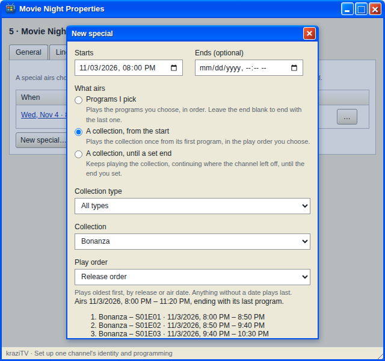

# Specials

A special puts exactly what you choose on the air at exactly the time you
choose. Book a movie for 8:00 PM on Friday, or every Harry Potter film in order starting at noon on a
snow day. Regular programming wraps up before it, and picks up afterward.

Specials live on the **Specials** tab of a channel's Properties. Where a
[rule](Rules) is a preference checked between programs, a special is a
promise: it starts exactly when you say.

## Making one

Click **New special…** and fill in:

- **Starts**: the date and time, up to a year ahead.
- **What airs**:
  - **Programs I pick**: a list of specific episodes or movies, in order.
  - **A collection, from the start**: a whole collection once, from its
    first program, in the play order you choose. The way to run a whole
    franchise or season in order.
  - **A collection, until a set end**: keep playing a collection until the
    end time, continuing from where the channel is up to in it.
- **Ends**: optional for the first two, which otherwise end with their last
  program. Required for the third.

Then click **Preview**. kraziTV shows exactly what the special will air,
minute by minute, and what it moves out of the way. If something stops the
special from being saved, the preview says what. Only when the preview is
clean does **Save special** become available. Any edit after that needs a
new preview.

## What happens around it

Regular programming stops whole before a special. A program that would not
finish in time is never cut; it stays next in line for its show and airs
the next time that show comes up. The gap before the special is what the
preview calls filler and the guide calls **Off air**. See [Off air and
other screens](Off-Air).

After the special, the rotation moves on to the next show. A special never
changes the lineup, the rules, or where any show is up to, except that
**A collection, until a set end** advances the channel's place in that
collection when it uses the same play order as the show, since it
continues from there.

A special beats every rule. Specials cannot overlap each other.

## Cutting in

If the start time falls inside the program that is on the air when you
click **Preview**, the preview says so and offers two choices:

- **Let it finish** moves the start to the end of that program.
- **Stop it at the special's start** cuts the program at your chosen time.
  Viewers stay tuned and see the special begin.

A **Start now** button cuts straight in at this moment. The cut is seamless
for everyone watching, unlike **Stop it now** on a lineup change, which
disconnects viewers. Only the program airing right now can be cut this
way; a special saved days ahead never cuts a future program.

## Upcoming, on air, ended

Each special in the list is **Upcoming**, **On air**, or **Ended**. Select
one to see what you can do with it.

- An upcoming special can be edited with **Edit…** or called off with
  **Cancel special…**, which gives the time back to regular programming.
- A special on the air can only be ended early, with **End early…**: let
  the current program finish and end with it, stop it now, or stop at a
  time you choose.
- An ended special stays in the list as history.

While a channel is showing the off-air gap leading into a special, that
special cannot be canceled and its start cannot move, because viewers were
already told when programming resumes. Edits that keep the start are
fine.

## Specials do not repeat

Each special is one date and time. A weekly movie night at exactly 8 PM is
one special per week. If "sometime Friday evening" is good enough, a
[rule](Rules) repeats on its own.

---

**Next:** [Off air and other screens](Off-Air), or try [Friday movie
night](Scenario-Movie-Night).
