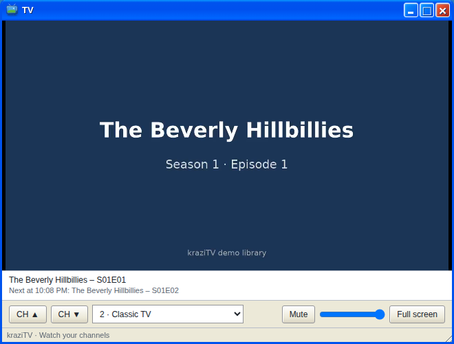

# TV

TV plays a channel in the browser. It is one more viewer of the same
broadcast Plex gets, so what you see is exactly what Plex viewers see.

- **CH ▲** and **CH ▼** step through the channels. The dropdown jumps to
  one.
- **Mute**, the volume slider, and **Full screen** do what they say.
  Double-clicking the picture also goes full screen.
- The strip under the picture names what is on and what is next.

TV opens on the channel you watched last. **Watch** in My Channels and a
channel's name in the Program Guide open TV on that channel.

Like every viewer, TV joins about ten seconds behind the schedule; see
[Connect Plex](Connect-Plex#watch). There is no pause or rewind. This is
live TV.

Every channel plays a file's first audio track and carries no subtitles.

Closing TV or changing channel leaves the broadcast; minimizing the window
keeps it playing. A channel nobody is watching stops encoding a few seconds
after its last viewer leaves, and starts again the next time someone tunes
in.

## No signal

When TV cannot play, it says why, with a **Try again** button. If the
browser blocks autoplay, a **Turn on the TV** button appears instead. The
usual reasons for no signal:

- The channel has nothing on the air. Check its lineup in
  [My Channels](My-Channels).
- Every channel is disabled, or none exist yet.
- The browser cannot play the stream. Some phone browsers cannot; Plex can.

---

**Next:** [Live Monitor](Live-Monitor), or back to [My Channels](My-Channels).
