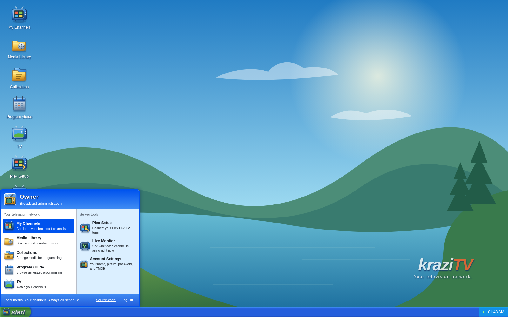

# The desktop

The web app is laid out like a Windows XP desktop. If you have used one, you
already know your way around. Nothing here changes what your channels do;
the desktop is just how you reach the programs.

## Programs

Every program has a shortcut on the desktop and an entry in the Start menu.
One click opens it. Each program opens once; opening it again brings its
window to the front.

| Program                              | What it is for                                             |
| ------------------------------------ | ---------------------------------------------------------- |
| [My Channels](My-Channels)           | Create channels and decide what they play                  |
| [Media Library](Media-Library)       | Add your media folders and scan them                       |
| [Collections](Collections)           | Group media into sets channels can play                    |
| [Program Guide](Program-Guide)       | See what every channel airs                                |
| [TV](TV)                             | Watch a channel in the browser                             |
| **Plex Setup**                       | The addresses Plex needs; see [Connect Plex](Connect-Plex) |
| [Live Monitor](Live-Monitor)         | See what one channel is airing right now                   |
| [Account Settings](Account-Settings) | Your name, picture, password, and TMDB                     |

## Windows

Windows move, resize, minimize, and maximize the way you expect. Drag the
title bar to move, drag the bottom-right corner to resize, and double-click
the title bar to maximize. Your browser remembers where you left each
window.

Some things open their own window rather than a page inside a program:

- **Channel Properties** opens from My Channels, one window per channel.
- **Collection Properties** opens from Collections, one window per
  collection.

Dialogs stay inside the window that opened them. A dialog in My Channels
blocks only My Channels; everything else keeps working.

If you close a window with unsaved edits, kraziTV asks whether to discard
them.

## The taskbar

Every open window has a button on the taskbar. Click one to bring that
window to the front or restore it from being minimized.

The system tray on the right holds:

- **A yellow warning icon** while TMDB is not set up. Click it to see why
  and to set it up. See [Account Settings](Account-Settings#set-up-tmdb).
- **A dot** that is green while the browser can reach kraziTV and amber
  when it cannot; hover it to read why. Clicking it opens Live Monitor.
- **The clock.**

## Start

The Start menu lists every program and has two more entries: **Source
code**, which opens kraziTV's GitHub page, and **Log Off**, which asks once
and then ends your session in this browser. Once Start is open, the arrow
keys move through it as they did on XP: Up and Down along a column, Left
and Right between the two columns, and Enter opens the highlighted program.
There is no Turn Off; kraziTV keeps broadcasting no matter what the desktop
is doing.

---

**Next:** [Media Library](Media-Library), where everything begins.
