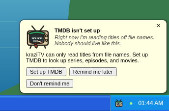

# The desktop

The web app is laid out like a Windows XP desktop. If you have used one, you
already know your way around. Nothing here changes what your channels do;
the desktop is just how you reach the programs.

## Programs

Every program has a shortcut on the desktop and an entry in the Start menu.
One click opens it. Each program opens once; opening it again brings its
window to the front. From the keyboard, Tab to the desktop shortcuts, move
between them with Up and Down (Home and End jump to the first and last),
and press Enter to open the highlighted one.

| Program                              | What it is for                                             |
| ------------------------------------ | ---------------------------------------------------------- |
| [My Channels](My-Channels)           | Create channels and decide what they play                  |
| [Media Library](Media-Library)       | Add your media folders and scan them                       |
| [Collections](Collections)           | Group media into sets channels can play                    |
| [Program Guide](Program-Guide)       | See what every channel airs                                |
| [TV](TV)                             | Watch a channel in the browser                             |
| **Plex Setup**                       | The addresses Plex needs; see [Connect Plex](Connect-Plex) |
| [Live Monitor](Live-Monitor)         | See what each channel is airing right now                  |
| [Account Settings](Account-Settings) | Your name, picture, password, and TMDB                     |

## Windows

Windows move, resize, minimize, and maximize the way you expect. Drag the
title bar to move, drag the bottom-right corner to resize, and double-click
the title bar to maximize. Your browser remembers where you left each
window.

Some things open their own window rather than a page inside a program:

- **Channel Properties** opens from My Channels, one window per channel.
- **Collection Properties** opens from Collections, one window per
  collection.

Dialogs stay inside the window that opened them. A dialog in My Channels
blocks only My Channels; everything else keeps working.

If you close a window with unsaved edits, kraziTV asks whether to discard
them.

## The taskbar

Every open window has a button on the taskbar. Click one to bring that
window to the front or restore it from being minimized.

The system tray on the right holds:

- **Gregg**, a small television's head, while kraziTV has something to
  tell you or files are being looked up on TMDB. See below.
- **A dot** that is green while the browser can reach kraziTV and amber
  when it cannot; hover it to read why. Clicking it opens Live Monitor.
- **The clock.**

## The tray and Gregg

Gregg is kraziTV's tray assistant: a tired beige television with rabbit
ears, an accountant's green visor, and a cigarette, who has seen every
shoebox of receipts and does the paperwork anyway. He never wanders around
the desktop. He sits in the tray and speaks through balloons, like the ones
XP's tray popped up.

Each balloon says plainly what is wrong and what its first button does;
Gregg's own remark sits in italics under the title. There is one icon and
one balloon at a time. Pointing at the icon shows the title of the balloon
it opens, and clicking it opens that balloon. When more than one thing
needs you, the balloon higher in this list comes first. The numbers in
the titles are examples:

| Balloon                                       | When                                                                                            | First button                                                                        |
| --------------------------------------------- | ----------------------------------------------------------------------------------------------- | ----------------------------------------------------------------------------------- |
| **TMDB isn't set up**                         | No TMDB key is saved. It pops up on its own only once you have a media root                     | **Set up TMDB** opens Account Settings on that task. See [Set up TMDB](Set-Up-TMDB) |
| **312 files haven't been looked up on TMDB**  | A key is saved, nothing is being scanned or looked up, and some files never were                | **Look them up** looks up every root's leftover files, failed lookups included      |
| **kraziTV found 14 shows and 3 movie series** | Nothing is left to look up, and kraziTV has collections to suggest that you have not decided on | **Make collections** opens [Collections](Collections) on **Discover collections**   |

Every balloon also has **Remind me later** and **Don't remind me**:

- **Remind me later**, the ✕, and Escape close it, and it does not pop up
  on its own again for 7 days. The first button counts the same.
- **Don't remind me** stops that balloon popping up on its own in this
  browser. Gregg's icon still shows while the balloon applies, so you can
  always click it.

Each balloon remembers its own answer, so silencing one never silences
another. A balloon pops up on its own at most once each time you open
kraziTV in your browser, which can be partway through, such as when
lookups finish. It never takes the keyboard away from the window you are
using. **kraziTV found…** comes back on its own only when there are more
suggestions than when you last answered it.

While files are being looked up on TMDB, Gregg's icon reads "Looking up
files on TMDB: 340 of 1,234". Clicking it shows the same count, with only a
✕ to close it; nothing pops up on its own while lookups run.

## Start

Start opens on your account's picture and name, as XP's did. Change either
in [Account Settings](Account-Settings). Below them, the Start menu lists
every program and has two more entries: **Source code**, which opens
kraziTV's GitHub page, and **Log Off**, which asks once and then ends your
session in this browser. Once Start is open, the arrow keys move through it
as they did on XP: Up and Down along a column, Home and End to its first
and last program, Left and Right between the two columns, and Enter opens
the highlighted program. There is no Turn Off; kraziTV keeps broadcasting
no matter what the desktop is doing.

---

**Next:** [Media Library](Media-Library), where everything begins.
