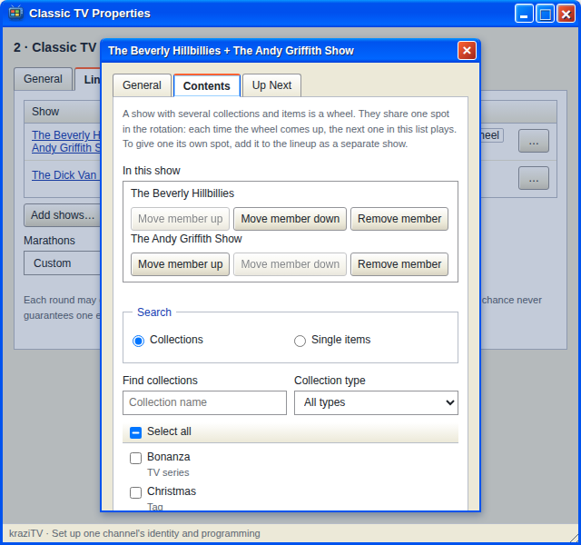

# Wheels

A wheel is one show that holds several collections. The wheel gets one turn
per round like any other show, and each time its turn comes up, the next
collection on the wheel plays.

The name comes from how networks once filled a slot: NBC's Sunday Mystery
Movie rotated Columbo, McCloud, and McMillan & Wife through the same time
each week. One slot, several shows taking turns inside it.

## When to use one

Use a wheel when several things should split one turn between them
instead of each getting a turn of its own.

Say a channel has five sitcoms and you want to add a dozen cartoons. As
separate shows, cartoons would take twelve of every seventeen turns and the
sitcoms would nearly vanish. As a wheel, the cartoons take one turn in six
and rotate among themselves, so each cartoon still comes around.

Other good wheels:

- Two or three shows from the same era that feel like one block.
- A "classic movie" wheel of several franchises, so the channel plays one
  franchise at a time without any one of them dominating.
- A handful of single episodes or specials that should appear now and then
  but never deserve a whole turn each.

## Making one

In **Add shows…**, tick two or more collections or files, choose **A
wheel** under **Add as**, and give it a name if you like. The order you
ticked them is the order they take turns.

To turn an existing show into a wheel, open its Properties, go to
**Contents**, and tick more collections. Arrange them with **Move member
up** and **Move member down**. A collection can be in only one show per
channel, so anything already on another show is marked as taken.

## How it plays

- Each member keeps its own place in its own collection, so a series on a
  wheel still airs in order from one visit to the next.
- Every member plays with the wheel's one **Play order** and **Plays at a
  time** setting.
- A member that cannot air is skipped and the next member takes the turn.
- A single file on a wheel plays once, whole, when its turn comes.
- If the wheel allows [marathons](Marathons), a marathon falls on whichever
  collection's turn it is. A single file never runs long: if the marathon
  lands on a file's turn, it plays once as usual and the marathon is lost
  for that round.

In the Lineup table, a wheel carries a **Wheel** badge under its name. In the Preview tab,
a wheel you named is listed under that name; an unnamed wheel's turns are
listed under the member that plays each one.

---

**Next:** [Marathons](Marathons).
